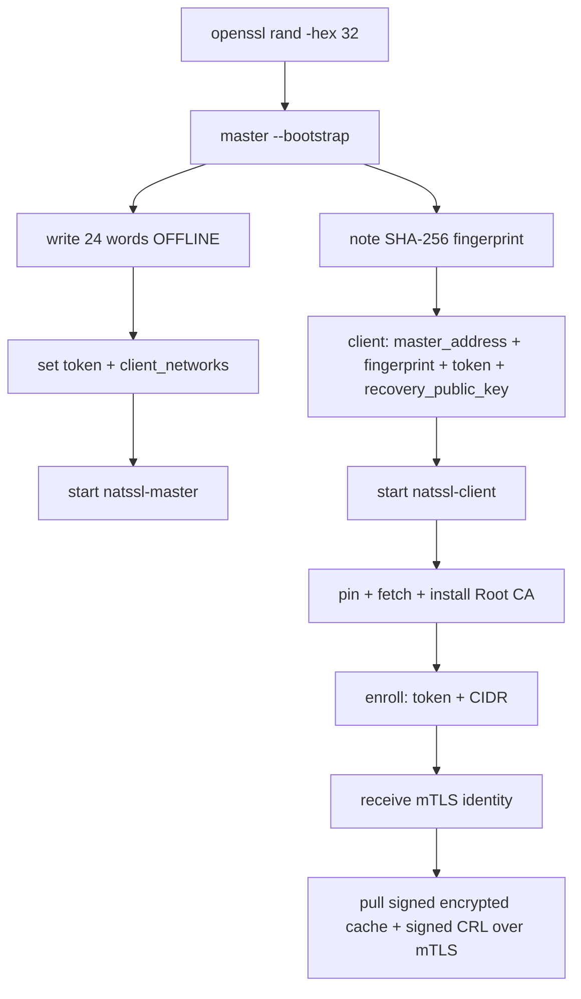
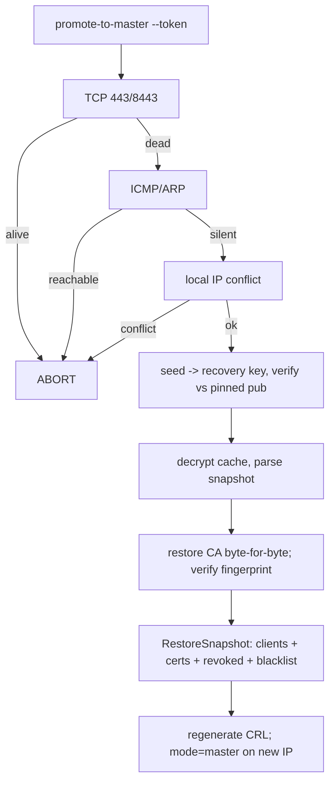

# NATSSL — Deployment Guide

## 1. Topology

| Role | Count (OSS) | Ports | Notes |
|---|---|---|---|
| Master | 1 | 443 (API), 8443 (control) | Root CA signs certs + CRL |
| Client | N | 8443 (signed migration receiver) | Self-enrolls via token + CIDR |

---

## 2. Security Controls

<details open>
<summary>2.1 Enrollment token</summary>

`openssl rand -hex 32` — same value on master + every client; compared in
constant time via `X-Enrollment-Token`.
</details>

<details>
<summary>2.2 Root CA pinning</summary>

`verifyMasterPin` checks the dedicated server identity, its hostname and its
server-auth chain to the exact pinned Root CA. A fingerprint match on an
unrelated certificate appended to a TLS chain is insufficient. Without a
fingerprint or local Root CA, bootstrap fails closed. For DNS addresses, add
the DNS name to the master config under `server_names`.
</details>

<details>
<summary>2.3 Issuance authorization</summary>

| Path | Who | Targets |
|---|---|---|
| `--issue` / `--reissue` | Admin on master | any domain / IP / wildcard |
| `/acme/sign-csr` | Enrolled client | loopback only (enforced twice) |
</details>

<details>
<summary>2.4 Blacklist</summary>

`--block <IP>` denies enrollment and every control-plane request from identities
registered for that IP (403), including existing TLS connections. The client is
removed from the registry. `--unblock` permits registration again. Explicitly
revoked identity certificates remain revoked.
</details>

---

## 3. Install

```bash
ARCH=$(uname -m); case "$ARCH" in x86_64) A=amd64;; aarch64|arm64) A=arm64;; esac
tar -xzf natssl-1.0.11-oss-linux-$A.tar.gz
sudo install -m0755 natssl-1.0.11-oss-linux-$A /usr/local/bin/natssl
sudo mkdir -p /etc/natssl /var/lib/natssl
sudo apt-get install -y libnss3-tools ca-certificates iputils-ping   # Debian/Ubuntu
sudo dnf install -y nss-tools iputils                            # RHEL/Rocky
sudo cp config.<role>.yaml /etc/natssl/config.yaml
sudo chmod 600 /etc/natssl/config.yaml
```

---

## 4. systemd

```bash
sudo cp natssl-*.service /etc/systemd/system/
sudo systemctl daemon-reload
sudo systemctl enable --now natssl-master   # or natssl-client
```

---

## 5. Rollout



---

## 6. Certificate Lifecycle

### 6.1 Admin issuance (master)
```bash
sudo natssl --mode=master --issue "app.internal"
sudo natssl --mode=master --issue "192.168.1.2"
sudo natssl --mode=master --issue "*.internal"
```
Files: `/var/lib/natssl/issued/<subject>.{crt,key}` (key `0600`); 90 days
(`--localhost` ⇒ 1 year, loopback SANs).

### 6.2 Reissue / rotate (master)
```bash
sudo natssl --mode=master --reissue "192.168.1.2"
```
Revokes current cert(s) → CRL → issues fresh → overwrites files → **publishes
the updated snapshot immediately; clients receive it on their next pull**.

### 6.3 Client issuance (loopback only)
```bash
sudo natssl --mode=client --issue "localhost" --localhost
natssl --mode=client --decrypt-key=/var/lib/natssl/issued/localhost.key.enc > key.pem
```

### 6.4 Revoke & CRL
```bash
sudo natssl --mode=master --revoke "<serial-hex>"
sudo natssl --mode=master --list-revoked
openssl crl -in /var/lib/natssl/root-ca.crl -noout -text
```
Records the serial, regenerates the **signed X.509 CRL** (`root-ca.crl`),
rebuilds and signs the encrypted cache. Clients pull `/sync/cache` and
`/sync/crl` over mTLS on port 8443. Changes are published immediately and
received on the next `pull_interval`; there is no cache/CRL push listener.
The CRL is regenerated on bootstrap, master startup, and before an expiring
CRL is served.

### 6.5 Client management
```bash
sudo natssl --mode=master --list-clients
sudo natssl --mode=master --deregister "192.168.10.21"
sudo natssl --mode=master --block "192.168.10.21" --block-reason "decommissioned"
sudo natssl --mode=master --unblock "192.168.10.21"
sudo natssl --mode=master --list-blocked
```

---

## 7. Disaster Recovery

Install `ping` (iputils) for the safety checks; missing or failed probe tools
block promotion. Fence the old master before promotion: failed network probes cannot distinguish
an outage from a network partition and do not guarantee the absence of split-brain.
Stop `natssl-client` on the host being promoted before running the foreground
promotion command, since both roles need port 8443. After successful promotion,
use the master systemd unit for subsequent starts; disable the client unit.




The locally stored `network-cache.enc` carries the **full state**: Root CA,
clients, issued certs (including mTLS identities), the **revoked set**, the
**blacklist**, enrollment policy and the monotonic replication/CRL counters. A promoted
master is therefore fully functional and knows the last replicated state.

> **Freshness:** equals the client's last successful sync before the master
> died. Revocations/blocks made after that point won't be present. Tune
> `pull_interval` accordingly.

---

## 8. Hardening Status

| Risk | Status |
|---|---|
| Spoofable registration | ✅ Token + CIDR |
| Pin ambiguity | ✅ Pin to Root CA, fail-closed |
| Host impersonation by clients | ✅ Loopback-only (twice) |
| Re-registration of rogue host | ✅ `--block` (immediate) |
| Revocation | ✅ Signed CRL over mTLS, published immediately and received on next pull |
| DR completeness | ✅ Snapshot restores certs + revoked + blacklist |
| Shared token | ⚠️ Rotate on compromise |
| Replication | ✅ Pull-only mTLS; signed cache envelope and persisted sequence reject rollback |
| Migration transport | ⚠️ Unpinned TLS; Root CA signature, freshness and persistent replay checks authenticate announcements |

---

## 9. Diagnostics

```bash
journalctl -u natssl-master | grep -i "enrolled\|signed\|denied\|CRL\|master online"
journalctl -u natssl-client | grep -i "pull\|enroll\|fingerprint\|CRL"
openssl x509 -in /var/lib/natssl/root-ca.crt -noout -fingerprint -sha256
openssl crl  -in /var/lib/natssl/root-ca.crl -noout -text
```

---

## 10. Common Errors

| Message | Fix |
|---|---|
| `invalid or missing enrollment token` (403) | Match the token on both sides. |
| `not in any allowed client network` (403) | Widen `client_networks`. |
| `this client is blacklisted` (403) | `--unblock` to allow. |
| `target not allowed for issuance` | Add a dot, use an IP, or `--localhost`. |
| `certificate %s is already revoked` | Serial already in the CRL. |
| `master certificate does not chain to pinned Root CA` | Wrong/stale fingerprint, or rogue master. |

---

## 11. FAQ

**Reissue vs revoke?** `--revoke <serial>` only revokes. `--reissue <subject>`
revokes the current cert(s) for that subject **and** issues a fresh one, then
publishes the result immediately; clients receive it on their next pull.

**Where is the CRL?** `/var/lib/natssl/root-ca.crl`, served only to enrolled clients at `/sync/crl` (`:8443`, mTLS).

**Does a promoted master know about revocations?** Yes — the snapshot includes
revoked serials and the blacklist; the CRL is regenerated on promotion.


## 12. Protocol upgrade and local development

Upgrade master and clients together: the control plane now requires enrolled
mTLS identities. Existing unsigned caches may be replaced by a newly signed
snapshot during authenticated synchronization, but are never accepted as a
recovery source. Perform a successful sync after upgrading, before relying on DR.
Root CA material is retained; do not bootstrap over an existing CA.

For custom ports set client `master_address: "host:9443"` and
`master_mgmt_address: "host:9843"`. IPv6 addresses with ports must be bracketed.
The latter defaults to the master host on 8443. For DNS hosts configure
`server_names: ["master.internal"]` on the master. Migration announcements use
the standard client receiver port 8443 and announce the standard master ports.
Use those ports for production DR.

Run `CGO_ENABLED=1 go test -race ./...`, `go vet ./...`, and the pure-Go Linux
amd64/arm64 builds. Integration tests create private temporary CAs, start real
TLS endpoints and exercise enrollment, issuance, revocation, replication,
rollback protection and recovery state. They do not install OS trust anchors or
change Firefox profiles. OS/Firefox integration and service-manager deployment
need validation on the target distribution.

## 13. Container and Ansible roles

The GHCR image is master-only, by default. It supports bootstrap and master
administration; client mode, client configs and promotion are disabled in its
compiled binary. Native clients enroll against the container master's published
ports. The container retains CA/database state in bind mounts and does not
install trust on the host. See
[docker deployment](../docker/README.md).

The Ansible roles deploy the full native release, verify release SHA-256, preserve
bootstrap/replay state, restart upgraded services and render the current mTLS
configuration. See [Ansible](../ansible/README.md) for variables and tested paths.
